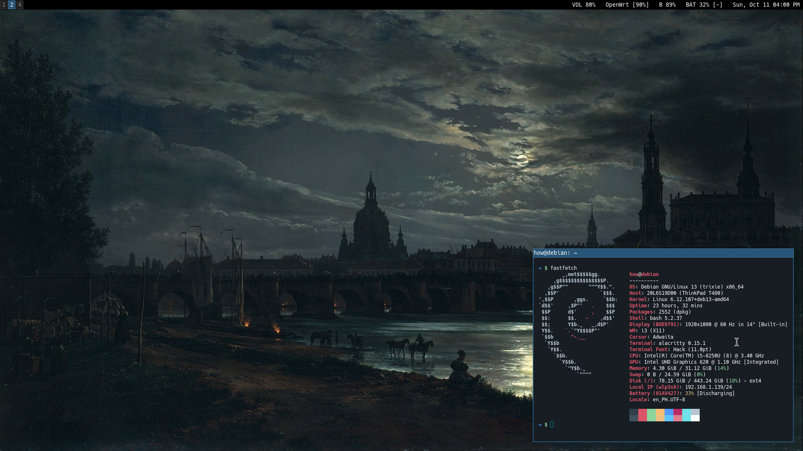

# Debian i3 Dotfiles

My current Debian setup for school, programming, embedded development, networking labs, and general daily use.

The goal is a simple and fast X11/i3 setup without a full desktop environment or compositor. I still use a few XFCE components for settings, power management, and notifications.



## Main setup

- Debian 13 / Trixie
- Xorg + `startx`
- i3
- i3blocks
- dmenu
- Alacritty
- Thunar
- Helium
- Sioyek
- nsxiv
- PulseAudio
- NetworkManager
- XSecureLock + xss-lock
- XFCE settings / power / notification backends
- MATE polkit agent
- No compositor

The dotfiles already contain the relevant `.bash_profile`, `.xinitrc`, i3, i3blocks, Alacritty, and Neovim configuration. X is started from TTY1 and the session services are launched from `.xinitrc`.

## Debian packages

```bash
sudo apt install \
    xorg \
    xinit \
    i3 \
    i3blocks \
    dmenu \
    alacritty \
    thunar \
    xfce4-settings \
    xfce4-power-manager \
    xfce4-notifyd \
    mate-polkit-bin \
    network-manager \
    pulseaudio \
    pulseaudio-utils \
    xss-lock \
    xsecurelock \
    brightnessctl \
    maim \
    xclip \
    xdotool \
    playerctl \
    nsxiv \
    fontconfig \
    git \
    curl \
    unzip \
    build-essential \
    gcc \
    g++ \
    python3 \
    python3-venv \
    ripgrep \
    fzf \
    cargo
```

Useful GTK / desktop plumbing:

```bash
sudo apt install \
    dbus-x11 \
    xdg-desktop-portal \
    xdg-desktop-portal-gtk \
    gvfs
```

## XFCE components

This is **not** a full XFCE desktop. I only keep the backend pieces that are useful under i3:

- `xfsettingsd` — GTK theme, fonts, DPI, and other X settings
- `xfce4-power-manager` — battery, suspend, lid, and power handling
- `xfce4-notifyd` — desktop notifications
- `mate-polkit` — graphical polkit authentication

Window management, panels, session management, and launching are handled by i3 / startx instead.

## Utilities used by the config

- `maim` — screenshots
- `xclip` — image/text clipboard
- `xdotool` — active-window screenshot handling
- `brightnessctl` — brightness keys / i3blocks
- `playerctl` — Termusic metadata and media controls in i3blocks
- `xss-lock` — integrates locking with system suspend
- `xsecurelock` — lock screen
- `fontconfig` — font discovery/cache (`fc-list`, `fc-match`, `fc-cache`)

## Neovim / development

My Neovim setup is used for C, C++, Python, LaTeX, and embedded development.

Tools used by the config include:

```text
gcc / g++
python3
ripgrep
fzf
git
Tree-sitter CLI
```

A recent Neovim build is recommended for the current config/plugins.

## ESP32 / PlatformIO

PlatformIO Core is used from the terminal instead of a full IDE.

Required Debian package:

```bash
sudo apt install python3-venv
```

PlatformIO itself is installed separately and exposes the `pio` command.

For serial access:

```bash
sudo usermod -aG dialout "$USER"
```

Log out and back in afterward. PlatformIO's `99-platformio-udev.rules` should also be installed for proper device access.

Current Neovim PlatformIO mappings:

```text
<leader>pb    build
<leader>pu    upload
<leader>pm    serial monitor
<leader>pr    upload + monitor
<leader>pc    clean
```

`<leader>r` compiles/runs regular C, C++, and Python files.

## LaTeX

```bash
sudo apt install \
    latexmk \
    texlive-latex-recommended \
    texlive-latex-extra \
    texlive-fonts-recommended \
    texlive-science \
    biber
```

VimTeX uses Sioyek as the PDF viewer.

## Other software

These are part of my setup but may need to be installed separately depending on the Debian repositories / installation method being used:

- Helium Browser
- Neovim
- Sioyek
- VirtualBox
- Termusic
- PlatformIO Core

## Fonts

User-installed fonts go in:

```text
~/.local/share/fonts/
```

After adding fonts:

```bash
fc-cache -fv
```

Check installed/resolved fonts with:

```bash
fc-list : family | sort -u
fc-match "Font Name"
```

## Notes

This setup intentionally does not use:

- a display manager
- a full XFCE session
- `xfwm4`
- an XFCE panel
- a compositor

The desktop flow is simply:

```text
TTY login -> startx -> i3
```

